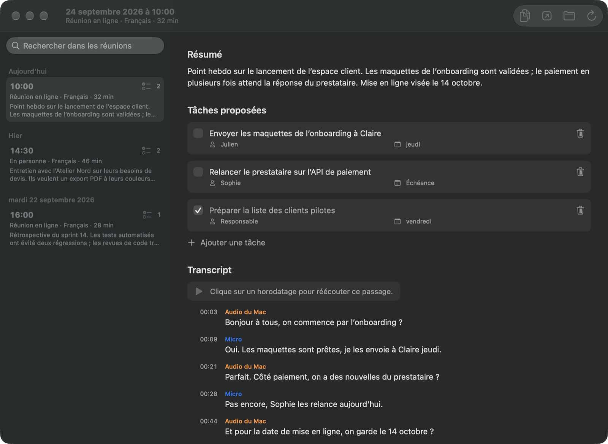

# Sillage

Une app pour Mac qui enregistre vos réunions depuis la barre de menus, puis en tire
une transcription et les tâches à faire, au format Markdown. Tout est traité sur
votre Mac : ni compte, ni envoi vers un serveur.

## Télécharger

**[⬇ Télécharger Sillage pour Mac](https://github.com/croustibat/sillage/releases/latest/download/Sillage.dmg)**
· [Toutes les versions](https://github.com/croustibat/sillage/releases)
· [Présentation](https://sillage-mac.vercel.app)

Configuration requise : Mac avec puce Apple, macOS 26 ou version ultérieure.
Apple Intelligence doit être activé pour l'extraction des tâches.

## Installation

1. Ouvrez `Sillage.dmg` et glissez **Sillage** dans **Applications**.
2. Lancez Sillage : son icône apparaît dans la barre de menus (pas dans le Dock).
3. Autorisez l'accès au micro et à l'audio du Mac lors du premier enregistrement.

L'app est signée et notarisée par Apple : elle s'ouvre sans avertissement. Les
enregistrements et comptes rendus sont rangés dans
`~/Library/Application Support/Sillage/`, un dossier qu'iCloud ne synchronise pas
(bouton **Voir les fichiers** dans le panneau de la barre de menus).

Ce dépôt ne contient que les versions publiées de l'app.
